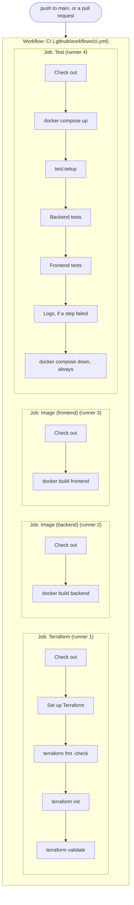

# PostHub's CI pipeline (GitHub Actions)

Every push to `main` and every pull request runs PostHub's continuous integration
(CI) pipeline on GitHub's servers. It checks that the project still builds and
its tests still pass on a clean machine, so a broken change shows up as a red
check on the pull request before it is merged. The pipeline only verifies; it
never deploys anything.

The pipeline is a single workflow file, `.github/workflows/ci.yml`. This document
explains it piece by piece.

## Anatomy of a workflow

* **Workflow:** a YAML file in `.github/workflows/`. GitHub runs it automatically
  when one of its triggers fires.
* **Trigger (`on:`):** the events that start a run. PostHub's workflow runs on
  pushes to `main` and on pull requests.
* **Job:** a unit of work that runs on its own fresh virtual machine, called a
  **runner**. `runs-on: ubuntu-26.04` asks for a GitHub-hosted Ubuntu machine.
  Jobs run in parallel unless one is told to wait for another.
* **Step:** one task inside a job. Steps run in order on the same runner, and the
  job fails as soon as one step fails.
  * `run:` executes shell commands. GitHub runs them with `bash -e`, so the step
    stops at the first command that exits with an error.
  * `uses:` runs an **action**, a reusable step published by someone else.
    `actions/checkout` copies the repository onto the runner, which starts empty.

PostHub's workflow, drawn with these terms. The matrix (explained in the images
job section) turns the images job into two jobs, so a run uses four runners:



The four jobs start at the same time, each on its own fresh runner, and share
nothing. Inside each job, the steps run in order, top to bottom.

Resources to dive deeper into:

* [Understanding GitHub Actions](https://docs.github.com/en/actions/get-started/understand-github-actions)
* [Events that trigger workflows](https://docs.github.com/en/actions/reference/workflows-and-actions/events-that-trigger-workflows)
* [GitHub's official actions](https://github.com/actions), such as `checkout`, `setup-node`, and `cache`
* [Creating Mermaid diagrams](https://docs.github.com/en/get-started/writing-on-github/working-with-advanced-formatting/creating-diagrams#creating-mermaid-diagrams), how GitHub renders them
* [Mermaid flowchart syntax](https://mermaid.js.org/syntax/flowchart.html)

### What gets tested on a pull request

On a pull request, the runner does not check out the branch's latest commit.
GitHub creates a temporary merge commit of the branch into `main` and tests that,
so a green check means the code still works *after* merging. That is why
`github.sha` on a pull request run differs from the commit at the tip of the branch.

Resources to dive deeper into:

* [Events that trigger workflows: `pull_request`](https://docs.github.com/en/actions/reference/workflows-and-actions/events-that-trigger-workflows#pull_request), including which commit `github.sha` points to

### Expressions: `${{ ... }}`

An expression is a value GitHub computes from the run's context before using it.
Expressions can appear in most keys of a workflow. For example, the `concurrency`
group (explained below) is built from two of them:

```yaml
concurrency:
  group: ${{ github.workflow }}-${{ github.head_ref || github.run_id }}
```

On a pull request from the `ci-pipeline` branch, the group becomes
`CI-ci-pipeline`.

Inside a `run:` step, GitHub replaces expressions *before* the shell command
runs:

```yaml
- run: echo "Triggered by ${{ github.event_name }} at commit ${{ github.sha }}"
```

On a pull request, the shell receives
`echo "Triggered by pull_request at commit 1a2b3c..."` and never sees the
expression. Because of this, untrusted values such as a pull request title
should never be placed inside `${{ }}` in a `run:` step: whoever writes that
text could inject shell commands.

Resources to dive deeper into:

* [Expressions](https://docs.github.com/en/actions/reference/workflows-and-actions/expressions), the `${{ }}` syntax and its operators
* [Script injections](https://docs.github.com/en/actions/concepts/security/script-injections)

## Limiting the workflow: `permissions`, `concurrency` and `timeout-minutes`

### `permissions`: least privilege for the token

Every run receives an automatic credential, the `GITHUB_TOKEN`, which actions
such as `checkout` use to call the GitHub API. What the token is allowed to do
depends on the scopes it is granted (`contents`, `issues`, `pull-requests`, and
so on), each set to `read`, `write`, or `none`.

* A top-level `permissions` key applies to every job in the workflow. Every scope
  not listed is set to `none`.
* A job can set its own `permissions`, which replaces the top-level value for
  that job.

**PostHub's choice:** `contents: read`, because the workflow only needs to read
the code. The repository's default token is already read-only, but it is still
set explicitly, for two reasons:

* The default is a repository setting, not code. It can be changed in the
  settings page, and other repositories (a fork, for example) may default to
  read and write. Declaring it in `ci.yml` makes it visible, reviewable, and the
  same everywhere.
* It is narrower than the default, which grants read access to every scope.
  `contents: read` grants access to the code only.

If an action the workflow runs were ever compromised, the token would let it do
nothing beyond reading code that is already public.

### `concurrency`: cancelling outdated runs

A concurrency group limits how many runs sharing the same group name can be
active at once: one running and one pending. A newer pending run replaces an
older pending one. Within a run, jobs still run in parallel, each on its own
runner.

* `group` is any string, and runs that produce the same string limit each other.
  Group names are shared across the whole repository.
* `cancel-in-progress: true` also cancels the run already in progress when a newer
  one joins the group. Without it, the outdated run would still finish.

**PostHub's choice:**

* The group starts with `github.workflow` (the workflow's name, `CI`), so a
  future workflow, such as a deploy workflow, can never land in the same group.
* On a pull request, `github.head_ref` is the branch name, so all pushes to one
  pull request share a group and only the latest commit is tested. On a push to
  `main`, `head_ref` is empty and `||` falls back to `github.run_id`, which is
  unique per run: every commit on `main` keeps its own result, so it is clear
  which commit broke it.
* `cancel-in-progress: true` is safe because this workflow only verifies.
  Stopping a deployment halfway could leave a server in a broken state, which is
  why deploy workflows often set it to `false`.

Resources to dive deeper into:

* [Workflow syntax: `permissions`](https://docs.github.com/en/actions/reference/workflows-and-actions/workflow-syntax#permissions)
* [About the `GITHUB_TOKEN`](https://docs.github.com/en/actions/concepts/security/github_token)
* [Managing GitHub Actions settings for a repository](https://docs.github.com/en/repositories/managing-your-repositorys-settings-and-features/enabling-features-for-your-repository/managing-github-actions-settings-for-a-repository#setting-the-permissions-of-the-github_token-for-your-repository), where the default token permissions are set
* [Workflow syntax: `concurrency`](https://docs.github.com/en/actions/reference/workflows-and-actions/workflow-syntax#concurrency)
* [Control workflow concurrency](https://docs.github.com/en/actions/how-tos/write-workflows/choose-when-workflows-run/control-workflow-concurrency)
* [Contexts reference](https://docs.github.com/en/actions/reference/workflows-and-actions/contexts), the values available in `github.*`

### `timeout-minutes`: capping each job

A job that hangs keeps running until it hits the default limit of 360 minutes
(6 hours). A test waiting on a connection that never opens, or a download that
stalls, would hold a runner the whole time. On a private repository, that would
also spend 360 of the 2,000 free minutes a month in a single run. Even when the
minutes are free, a failure that takes six hours to appear is a slow failure.

`timeout-minutes` cancels the job after the given number of minutes and marks
it as failed. Unlike `permissions` and `concurrency`, it has no workflow-level
form: it is set per job (or per step), and `defaults` cannot carry it. In a
matrix job, it applies to each matrix job separately.

**PostHub's choice:** `timeout-minutes: 10` on every job. On the runner, the
slowest job, the test job, takes about 80 seconds (stack start 39 s, backend
tests 13 s, frontend tests 16 s), and the others finish in under 30 seconds.
The same test steps took about 6 minutes on a development laptop, so run times
vary a lot from machine to machine. 10 minutes leaves room for a slow runner
while still failing a hang 36 times sooner than the default. The Terraform and
image jobs need the cap too: downloading Terraform, its providers, base images
and npm packages are all network calls that can hang. If a job grows, raise
its limit as needed.

Resources to dive deeper into:

* [Workflow syntax: `jobs.<job_id>.timeout-minutes`](https://docs.github.com/en/actions/reference/workflows-and-actions/workflow-syntax#jobsjob_idtimeout-minutes)
* [Workflow syntax: `defaults`](https://docs.github.com/en/actions/reference/workflows-and-actions/workflow-syntax#defaults)
* [Actions limits](https://docs.github.com/en/actions/reference/limits)

## Checking the infrastructure code: the Terraform job

The `terraform` job checks the Terraform code in `infra/` without an AWS account:
it never reads real infrastructure, needs no credentials, and changes nothing.

```yaml
terraform:
  name: Terraform
  runs-on: ubuntu-26.04
  timeout-minutes: 10
  defaults:
    run:
      working-directory: infra
  steps:
    - name: Check out the repository
      uses: actions/checkout@3d3c42e5aac5ba805825da76410c181273ba90b1 # v7.0.1
      with:
        persist-credentials: false

    - name: Set up Terraform
      uses: hashicorp/setup-terraform@dfe3c3f87815947d99a8997f908cb6525fc44e9e # v4.0.1
      with:
        terraform_version: 1.15.9
        terraform_wrapper: false

    - name: Check formatting
      run: terraform fmt -check -diff -recursive

    - name: Initialise without a backend
      run: terraform init -backend=false -input=false -lockfile=readonly

    - name: Validate the configuration
      run: terraform validate
```

`name: Terraform` is the job's display name, which is also the name of the check
shown on a pull request.

### Actions from the Marketplace

An action is a repository with an `action.yml` file that declares its inputs and
the code it runs. The GitHub Marketplace is a catalogue of such repositories.
Inputs are passed with `with:`, much like function arguments.

* **`actions/checkout`** clones the repository into the runner's workspace. By
  default it fetches only the triggering commit (`fetch-depth: 1`) and leaves the
  job's `GITHUB_TOKEN` in `.git/config` so later steps can run authenticated `git`
  commands.
* **`hashicorp/setup-terraform`** downloads the Terraform CLI and adds it to the
  `PATH`. By default it also installs a **wrapper script**: a small program named
  `terraform` that runs the real binary and saves its output and exit code as
  step outputs, for later steps to read (for example, to post a `plan` as a
  pull request comment).

**PostHub's choice:**

* `persist-credentials: false`: nothing in the job runs `git`, so the token is
  not left on disk for later steps to pick up.
* `terraform_version: 1.15.9`: the default, `latest`, could break the build the
  day a new Terraform release changes behaviour, with no change in the code. The
  pinned version matches the one used locally, so CI and the developer format
  the code identically. Both are upgraded together.
* `terraform_wrapper: false`: no step reads Terraform's output, so the wrapper
  would only add a layer between the job and Terraform.

Resources to dive deeper into:

* [GitHub Marketplace: actions](https://github.com/marketplace?type=actions), the catalogue of published actions
* [About custom actions](https://docs.github.com/en/actions/concepts/workflows-and-actions/custom-actions)
* [Metadata syntax for `action.yml`](https://docs.github.com/en/actions/reference/workflows-and-actions/metadata-syntax)
* [`actions/checkout`](https://github.com/actions/checkout), its source and inputs
* [`hashicorp/setup-terraform`](https://github.com/hashicorp/setup-terraform), its source and inputs; the [usage section](https://github.com/hashicorp/setup-terraform#usage) covers the wrapper

### Pinning actions by commit SHA

To *pin* a dependency is to fix it to an exact version, so it changes only when
someone edits the reference. The opposite is a *floating* reference, which can
point to something different over time without any edit, such as
`terraform_version: latest` or `runs-on: ubuntu-latest`. Pins differ in how
tight they are: a commit SHA always means exactly the same code, while a runner
label such as `ubuntu-26.04` fixes the OS version but not every package on it
(see [Choosing the runner OS](#choosing-the-runner-os-runs-on)). Lock files pin
in the same sense: `package-lock.json` for npm packages and
`.terraform.lock.hcl` for the AWS provider.

The text after `@` in `uses:` is a git reference in the action's repository:

| Reference | Example | Can it change? |
| --- | --- | --- |
| Branch | `@main` | Yes, with every push |
| Tag | `@v4`, `@v4.0.1` | Yes, a tag is a movable pointer |
| Commit SHA | `@dfe3c3f8...` (40 characters) | No, the SHA is a hash of the commit's content |

An action runs with access to the job's files and token, so a tag that is
repointed to malicious code reaches every workflow using it on its next run.
This happened in March 2025 to `tj-actions/changed-files`: its tags were
repointed to a commit that printed CI secrets into build logs. Workflows pinned
to a SHA kept running the previous code.

**PostHub's choice:** both actions are pinned to a full SHA, with the version
as a comment for human readers. A pin never updates itself, so new versions must
be adopted deliberately; Dependabot can automate this by opening a pull request
that updates both the SHA and the comment.

Resources to dive deeper into:

* [Secure use reference: using third-party actions](https://docs.github.com/en/actions/reference/security/secure-use)
* [Workflow syntax: `jobs.<job_id>.steps[*].uses`](https://docs.github.com/en/actions/reference/workflows-and-actions/workflow-syntax#jobsjob_idstepsuses)
* [Keeping your actions up to date with Dependabot](https://docs.github.com/en/code-security/dependabot/working-with-dependabot/keeping-your-actions-up-to-date-with-dependabot)
* [GHSA-mrrh-fwg8-r2c3](https://github.com/advisories/GHSA-mrrh-fwg8-r2c3), the `tj-actions/changed-files` advisory (CVE-2025-30066)

### Running in `infra/`: `working-directory`

Every `run:` step starts in the workspace root, but the Terraform code lives in
`infra/`. The working directory can be set on a single step
(`working-directory:`), for a whole job, or for the whole workflow
(`defaults.run.working-directory`). The most specific setting wins. It applies
only to `run:` steps; actions in `uses:` steps decide for themselves where they
work.

**PostHub's choice:** the job-level default, since every command in this job is
a Terraform command in `infra/`. A workflow-level default would be wrong: other
jobs run from the repository root. Terraform's own `-chdir=infra` flag would
also work, but it must be repeated on every command.

Resources to dive deeper into:

* [Workflow syntax: `jobs.<job_id>.defaults.run`](https://docs.github.com/en/actions/reference/workflows-and-actions/workflow-syntax#jobsjob_iddefaultsrun)
* [Workflow syntax: `jobs.<job_id>.steps[*].working-directory`](https://docs.github.com/en/actions/reference/workflows-and-actions/workflow-syntax#jobsjob_idstepsworking-directory)
* [Terraform: switching working directory with `-chdir`](https://developer.hashicorp.com/terraform/cli/commands#switching-working-directory-with-chdir)

### The three checks

1. **`terraform fmt -check -diff -recursive`** checks that every file follows
   Terraform's canonical style (indentation, aligned `=`, spacing).
   * `-check` changes nothing and exits with a non-zero code if any file needs
     formatting, which fails the step.
   * `-diff` prints the exact change needed in the log.
   * `-recursive` includes subdirectories, which are skipped by default.

   It runs first because it needs no downloads, so a formatting mistake fails in
   seconds. To fix a failure, run `terraform fmt -recursive` in `infra/` and
   commit the result.
2. **`terraform init -backend=false -input=false -lockfile=readonly`** downloads
   the AWS provider, which `validate` needs: the provider's schema defines which
   resources and arguments exist.
   * `-backend=false` skips connecting to where state is stored. `infra/` stores
     state locally today, but if a remote backend such as S3 is added, plain
     `init` would need AWS credentials, which a syntax check should never have.
   * `-input=false` makes Terraform fail instead of waiting for input that no
     one can type.
   * `-lockfile=readonly` makes `init` fail rather than change
     `.terraform.lock.hcl`, so CI only ever uses the provider versions and
     checksums committed in the lock file. To fix a failure, run `terraform init`
     locally (with `-upgrade` after changing a version constraint) and commit
     the lock file.
3. **`terraform validate`** checks that the configuration is consistent with
   itself and with the provider's schema: references point to things that are
   declared, arguments exist, and values have the right types. Each error
   names the file and line, often with a "Did you mean" suggestion.

### What this job does not check

`validate` checks structure, not the real world. It cannot know whether an AMI
exists, whether an S3 bucket name is taken, or whether IAM allows an action.
Those only surface in `terraform plan` or `apply`, which need AWS credentials
and are outside this pipeline while the infrastructure is not deployed.

Resources to dive deeper into:

* [`terraform fmt`](https://developer.hashicorp.com/terraform/cli/commands/fmt)
* [Terraform style guide](https://developer.hashicorp.com/terraform/language/style)
* [`terraform init`](https://developer.hashicorp.com/terraform/cli/commands/init)
* [Dependency lock file](https://developer.hashicorp.com/terraform/language/files/dependency-lock)
* [`terraform validate`](https://developer.hashicorp.com/terraform/cli/commands/validate)

## Building the production images: the images job

The `images` job builds the `production` stage of both Dockerfiles, the images
that would be deployed.

```yaml
images:
  name: Image (${{ matrix.service }})
  runs-on: ubuntu-26.04
  timeout-minutes: 10
  strategy:
    fail-fast: false
    matrix:
      service: [backend, frontend]
  steps:
    - name: Check out the repository
      uses: actions/checkout@3d3c42e5aac5ba805825da76410c181273ba90b1 # v7.0.1
      with:
        persist-credentials: false

    - name: Build the production image
      run: docker build --target production --tag posthub-${{ matrix.service }}:ci ${{ matrix.service }}
```

It appears on a pull request as two checks, `Image (backend)` and
`Image (frontend)`, next to `Terraform`.

### Parallel jobs and `needs`

Jobs in a workflow run at the same time by default, each on its own fresh
virtual machine. They share no files, tools, or Docker images, which is why
every job starts with its own checkout.

`needs` makes a job wait for another:

```yaml
jobs:
  deploy:
    needs: build   # starts only after build succeeds
```

It does two things: it orders the jobs, and it skips the dependent job when the
one it needs fails. That suits work that must happen in sequence, such as
deploying only after the build and tests pass.

**PostHub's choice:** no `needs`. The checks are independent: whether the
Terraform code is formatted has nothing to do with whether the images build.
Running them in parallel means:

* The run takes as long as the slowest job, not the sum of all jobs.
* Every failure shows up in the same run. With `needs`, a second failure would
  only appear after fixing the first.
* Each job is its own check on the pull request.

Resources to dive deeper into:

* [Using jobs in a workflow](https://docs.github.com/en/actions/how-tos/write-workflows/choose-what-workflows-do/use-jobs)
* [Workflow syntax: `jobs.<job_id>.needs`](https://docs.github.com/en/actions/reference/workflows-and-actions/workflow-syntax#jobsjob_idneeds)

### Steps or jobs?

`needs` orders jobs but does not put them on the same machine: a dependent job
starts on a new VM, without anything the earlier job produced. Results have to
be passed on explicitly:

| What to pass | Mechanism | Example |
| --- | --- | --- |
| A short string | Job `outputs`: written to `$GITHUB_OUTPUT`, read as `needs.<job>.outputs.<name>` | A version number or image tag |
| Files | Artifacts: `actions/upload-artifact`, then `actions/download-artifact` | A compiled `dist/` or a test report |
| A Docker image | A registry: push, then pull | Build an image, then deploy it |

When tasks share files or running processes, steps in one job are simpler and
faster: no second VM to start and nothing to transfer. Separate jobs are worth
it when the parts need a different machine (another OS, more memory), different
permissions or secrets (a deploy job holding cloud credentials), should run in
parallel, or should be visible and re-runnable on their own.

Resources to dive deeper into:

* [Passing information between jobs](https://docs.github.com/en/actions/how-tos/write-workflows/choose-what-workflows-do/pass-job-outputs)
* [Workflow syntax: `jobs.<job_id>.outputs`](https://docs.github.com/en/actions/reference/workflows-and-actions/workflow-syntax#jobsjob_idoutputs)
* [Storing and sharing data from a workflow](https://docs.github.com/en/actions/tutorials/store-and-share-data)
* [`actions/upload-artifact`](https://github.com/actions/upload-artifact)
* [GitHub-hosted runners](https://docs.github.com/en/actions/concepts/runners/github-hosted-runners)

### One job, two images: `strategy.matrix`

The two builds differ only in the folder, so the job is written once with a
matrix. GitHub expands it into one job per value, `backend` and `frontend`,
each on its own VM and in parallel. Steps read the current value with
`${{ matrix.service }}`. Here it is safe to use in `run:`, since the values come
from the workflow itself, not from user input. With several variables, the
matrix runs every combination, and `include` and `exclude` add or remove
combinations.

**PostHub's choice:**

* `fail-fast: false`. The default, `true`, cancels the remaining jobs as soon as
  one fails. That would hide whether the other image also builds.
* An explicit `name:` containing the matrix value, so the check names are
  predictable when choosing which checks are required.
* `max-parallel` is left at its default (no limit), since there are only two
  jobs.

Resources to dive deeper into:

* [Running variations of jobs in a workflow](https://docs.github.com/en/actions/how-tos/write-workflows/choose-what-workflows-do/run-job-variations)
* [Workflow syntax: `jobs.<job_id>.strategy.matrix`](https://docs.github.com/en/actions/reference/workflows-and-actions/workflow-syntax#jobsjob_idstrategymatrix)
* [Workflow syntax: `include`](https://docs.github.com/en/actions/reference/workflows-and-actions/workflow-syntax#jobsjob_idstrategymatrixinclude) and [`exclude`](https://docs.github.com/en/actions/reference/workflows-and-actions/workflow-syntax#jobsjob_idstrategymatrixexclude)
* [Workflow syntax: `fail-fast`](https://docs.github.com/en/actions/reference/workflows-and-actions/workflow-syntax#jobsjob_idstrategyfail-fast)
* [Workflow syntax: `max-parallel`](https://docs.github.com/en/actions/reference/workflows-and-actions/workflow-syntax#jobsjob_idstrategymax-parallel)

### What the build proves

`docker-compose.yml` builds the `dev` stage, which copies the source and
compiles nothing. Only the `build` stage compiles, and only `production` uses
it, so without this job a change could pass every test and still break the
image that would be deployed. A successful build shows that:

* `npm ci` installs exactly what the lock file lists, on a clean machine.
* The code compiles: `tsc` for the backend; `tsc --noEmit` and `vite build` for
  the frontend.
* The final stage assembles: `npm ci --omit=dev`, `dist/` and `migrations/` for
  the backend; `nginx.conf` and the bundle for the frontend.
* `.dockerignore` does not exclude anything the build needs.

It does not show that the containers start, that the app works (the test job's
role), or that `nginx.conf` is valid, since nginx reads it only at startup.

### `docker build` or `docker/build-push-action`

Docker is preinstalled on GitHub's Ubuntu runners, so a `run:` step can call
`docker build` directly. Docker's official action, `docker/build-push-action`
(usually with `docker/setup-buildx-action`), adds pushing to a registry,
multi-platform builds, and layer caching between runs through the GitHub
Actions cache (`type=gha`).

**PostHub's choice:** plain `docker build`, the same command
[docs/docker.md](docker.md) uses. Nothing is pushed while the infrastructure is
not deployed, and it adds no third-party action to pin. The cost is no cache:
every run builds from scratch, including `npm ci`. The action becomes worth it
once images are pushed or build time starts to matter.

Resources to dive deeper into:

* [Multi-stage builds](https://docs.docker.com/build/building/multi-stage/)
* [`docker build` reference](https://docs.docker.com/reference/cli/docker/buildx/build/)
* [Docker build with GitHub Actions](https://docs.docker.com/build/ci/github-actions/)
* [`docker/build-push-action`](https://github.com/docker/build-push-action)
* [GitHub Actions cache backend](https://docs.docker.com/build/cache/backends/gha/)

### Choosing the runner OS: `runs-on`

`runs-on` takes a label that selects a runner image: an OS plus preinstalled
tools. `ubuntu-latest` is an alias that GitHub moves to each new LTS. From
October 19 to November 19, 2026 it moves from Ubuntu 24.04 to 26.04, so during
that window two runs of the same commit can land on different systems.
`ubuntu-24.04` and `ubuntu-26.04` are fixed versions.

The images job depends on the runner's Docker, which differs between the two
(versions as of October 2026):

| Tool | `ubuntu-24.04` | `ubuntu-26.04` |
| --- | --- | --- |
| Docker | 28.0.4 | 29.4.2 |
| Docker Compose | 2.38.2 | 5.1.3 |

A label is a looser pin than a SHA: GitHub rebuilds the images about weekly
with patches and minor tool updates. It fixes the OS and the major tool
versions, not every package.

**PostHub's choice:** `ubuntu-26.04` on every job. Results do not depend on
which OS a run lands on, it matches the other pins, and its Docker and Compose
major versions match a current local setup. The Terraform job installs its own
Terraform and would work on either image; it uses the same label to keep the
workflow uniform. The label needs a manual bump at the next LTS, which GitHub
announces in the runner-images repository.

Resources to dive deeper into:

* [Workflow syntax: `jobs.<job_id>.runs-on`](https://docs.github.com/en/actions/reference/workflows-and-actions/workflow-syntax#jobsjob_idruns-on)
* [GitHub-hosted runners](https://docs.github.com/en/actions/concepts/runners/github-hosted-runners)
* [`ubuntu-latest` migration to Ubuntu 26.04](https://github.com/actions/runner-images/issues/14748)
* [Ubuntu 26.04 image software](https://github.com/actions/runner-images/blob/main/images/ubuntu/Ubuntu2604-Readme.md)
* [Ubuntu 24.04 image software](https://github.com/actions/runner-images/blob/main/images/ubuntu/Ubuntu2404-Readme.md)

## Running the tests: the test job

The `test` job starts the development stack with Docker Compose and runs both
test suites inside the containers, the same way the README describes.

```yaml
test:
  name: Test
  runs-on: ubuntu-26.04
  timeout-minutes: 10
  steps:
    - name: Check out the repository
      uses: actions/checkout@3d3c42e5aac5ba805825da76410c181273ba90b1 # v7.0.1
      with:
        persist-credentials: false

    - name: Start the development stack
      run: docker compose up --detach --build --wait

    - name: Create and migrate the test database
      run: docker compose exec -T api npm run test:setup

    - name: Run the backend tests
      run: docker compose exec -T api npm test

    - name: Run the frontend tests
      run: docker compose exec -T web npm test

    - name: Show the container logs
      if: failure()
      run: docker compose logs

    - name: Stop the stack and remove its volumes
      if: always()
      run: docker compose down --volumes
```

### A multi-container stack in CI

Docker and Compose come preinstalled on GitHub's Ubuntu runners, so the job
needs no setup action. `docker compose up` reads `docker-compose.yml` as written
and starts `db`, `api` and `web` on the `dev` target. Three flags matter here:

* `--detach` hands control back once the containers start. Without it, `up`
  stays attached to the logs and the step never ends.
* `--build` builds the images from the checked-out code. Each job gets a fresh
  machine, so there is no image cache from earlier runs.
* `--wait` returns only when every container is running and `db` passes its
  `pg_isready` healthcheck, so the next step never finds Postgres still
  starting.

The `posthub_pgdata` volume starts empty on every run, and the committed
`${VAR:-posthub}` defaults apply because the runner has no `.env`. Every run
starts from the same state.

GitHub's own approach is **service containers** (`jobs.<job_id>.services`):
Postgres runs next to the job, and the tests run with Node directly on the
runner. That is the more common pattern.

**PostHub's choice:** Compose. The test scripts hardcode the `db` host in
`DATABASE_URL`, and only the Compose network resolves that name. Compose also
checks that the README's `docker compose up` works on a clean machine. The cost
is time: building the dev images is slower than installing Node packages
directly.

Resources to dive deeper into:

* [Docker Compose `up` reference](https://docs.docker.com/reference/cli/docker/compose/up/)
* [Using Docker service containers](https://docs.github.com/en/actions/tutorials/use-containerized-services/use-docker-service-containers)
* [GitHub-hosted runner images](https://github.com/actions/runner-images)

### Running commands in a container: `exec -T`

`docker compose exec` runs a command in a container that is already running,
with its files, its `node_modules`, and its place on the Compose network.
`docker compose run` would start a new one-off container instead, which isn't
needed when `up` has already started the stack.

By default, `exec` allocates a pseudo-terminal (TTY), which is what makes an
interactive session work locally. A runner has no terminal attached, and `-T`
turns the TTY off. That avoids errors such as `the input device is not a TTY`,
and it keeps stdout and stderr separate in the run log.

`exec` exits with the command's own exit code. A failing test makes `vitest`
exit 1, so `docker compose exec` exits 1, the step fails, and the job goes red.

**PostHub's choice:** every command in the test job uses
`docker compose exec -T <service> ...`.

Resources to dive deeper into:

* [Docker Compose `exec` reference](https://docs.docker.com/reference/cli/docker/compose/exec/)
* [Docker Compose `run` reference](https://docs.docker.com/reference/cli/docker/compose/run/)
* [Workflow syntax: `jobs.<job_id>.steps[*].shell`](https://docs.github.com/en/actions/reference/workflows-and-actions/workflow-syntax#jobsjob_idstepsshell)

### What the job runs

Each command is its own step, so the run page shows a separate log, duration
and result for each one:

1. `test:setup` creates `posthub_test` and runs the migrations on it. On a
   fresh volume, the database does not exist yet, so the README's one-time step
   runs on every CI run. The script is idempotent.
2. The backend suite runs its unit tests, then its integration tests against
   `posthub_test` with supertest.
3. The frontend suite runs its unit tests, then its integration tests against
   MSW. It needs neither `db` nor `api`, but it runs in `web` because that is
   where the frontend's `node_modules` live.

A failing step skips the steps after it, so a red backend suite means the
frontend tests do not run in that job.

**PostHub's choice:** no separate typecheck steps. Vitest strips types without
checking them, so a typecheck has to run somewhere. The images job already runs
one: `npm run build` runs `tsc` with the same `tsconfig.json` for both the
backend and the frontend. Repeating it here would run the same check twice.

Resources to dive deeper into:

* [Vitest: getting started (TypeScript support)](https://vitest.dev/guide/)
* [Vitest: test projects](https://vitest.dev/guide/projects)

### Steps that run anyway: `if: always()` and `if: failure()`

Every step has an implicit `if: success()`: once a step fails, the following
steps are skipped. Status check functions change that:

| Function | The step runs when... |
| --- | --- |
| `success()` (default) | all previous steps succeeded |
| `failure()` | a previous step failed |
| `cancelled()` | the run was cancelled |
| `always()` | in every case, including after a cancellation |

GitHub recommends `if: ${{ !cancelled() }}` for most "run anyway" steps,
because a step under `always()` that hangs can hold up a cancellation.
`docker compose down` is quick and safe to run after a cancellation, so
`always()` fits it.

On a GitHub-hosted runner, the machine is destroyed after the job, together
with its containers and volumes, so teardown is not strictly needed. It matters
on a self-hosted runner, which is reused: leftover containers would hold port
5432, and a leftover volume would carry data into the next run.

**PostHub's choice:** two steps that run outside the normal flow:

* `docker compose logs` with `if: failure()`. When `api` crashes or a test
  fails because of the database, the container logs explain why, and the run
  log is the only place they survive once the machine is gone.
* `docker compose down --volumes` with `if: always()`. It costs a few seconds,
  and the job stays correct if it ever moves to a reused machine.

Resources to dive deeper into:

* [Expressions: status check functions](https://docs.github.com/en/actions/reference/workflows-and-actions/expressions#status-check-functions)
* [Workflow syntax: `jobs.<job_id>.steps[*].if`](https://docs.github.com/en/actions/reference/workflows-and-actions/workflow-syntax#jobsjob_idstepsif)
* [Docker Compose `logs` reference](https://docs.docker.com/reference/cli/docker/compose/logs/)
* [Docker Compose `down` reference](https://docs.docker.com/reference/cli/docker/compose/down/)

## Blocking merges: the "CI must pass" ruleset

A red check on a pull request is only a signal: by default, the Merge button
still works. To make CI a gate, the target branch needs a rule that requires
the checks to pass. That rule is a repository setting stored by GitHub, not
part of `ci.yml`.

### Rulesets or branch protection rules

GitHub has two ways to protect a branch:

* **Branch protection rules**, the older feature. Only one rule applies to a
  branch, and admins bypass it unless "Do not allow bypassing the above
  settings" is ticked.
* **Rulesets**, the newer one. Several rulesets can apply to the same branch,
  and their rules are combined: where two define the same rule differently, the
  most restrictive version wins. A ruleset can be switched between active and
  disabled without deleting it, anyone with read access can see the active
  ones, and only the actors on its bypass list can skip it.

**PostHub's choice:** a ruleset. Rulesets are available in public repositories
on GitHub Free, their bypass list is explicit instead of a checkbox, and a
ruleset can be disabled and re-enabled without losing its settings.

Resources to dive deeper into:

* [About rulesets](https://docs.github.com/en/repositories/configuring-branches-and-merges-in-your-repository/managing-rulesets/about-rulesets)
* [About protected branches](https://docs.github.com/en/repositories/configuring-branches-and-merges-in-your-repository/managing-protected-branches/about-protected-branches)

### The ruleset file: `.github/rulesets/main.json`

```json
{
  "name": "CI must pass",
  "target": "branch",
  "enforcement": "active",
  "conditions": {
    "ref_name": { "include": ["~DEFAULT_BRANCH"], "exclude": [] }
  },
  "bypass_actors": [],
  "rules": [
    {
      "type": "required_status_checks",
      "parameters": {
        "strict_required_status_checks_policy": true,
        "do_not_enforce_on_create": false,
        "required_status_checks": [
          { "context": "Terraform", "integration_id": 15368 },
          { "context": "Image (backend)", "integration_id": 15368 },
          { "context": "Image (frontend)", "integration_id": 15368 },
          { "context": "Test", "integration_id": 15368 }
        ]
      }
    }
  ]
}
```

GitHub never reads this file. It is the request body that created the
ruleset, kept in the repository as a record. If the ruleset is changed in the
web UI, the file falls out of date, so changes should go through the file and
the `PUT` request shown below.

Nothing in it is secret. The app ID is public, the check names appear on every
pull request, and the ruleset of a public repository, including its ID, can be
read without logging in. Creating, changing or deleting it requires admin
access to the repository.

| Field | Meaning | Docs |
| --- | --- | --- |
| `name` | The label shown in the repository settings. | [REST body parameters](https://docs.github.com/en/rest/repos/rules?apiVersion=2022-11-28#create-a-repository-ruleset--parameters) |
| `target` | What the ruleset protects: `branch`, `tag` or `push`. | [REST body parameters](https://docs.github.com/en/rest/repos/rules?apiVersion=2022-11-28#create-a-repository-ruleset--parameters) |
| `enforcement` | `active` enforces it; `disabled` keeps it without enforcing it. (`evaluate` needs GitHub Enterprise.) | [Enforcement statuses](https://docs.github.com/en/repositories/configuring-branches-and-merges-in-your-repository/managing-rulesets/creating-rulesets-for-a-repository#using-ruleset-enforcement-statuses) |
| `conditions.ref_name` | Which branches it covers. `~DEFAULT_BRANCH` includes the default branch (`main`); `~ALL` would include every branch. | [Conditions object](https://docs.github.com/en/rest/repos/rules?apiVersion=2022-11-28#create-a-repository-ruleset-conditions-object), [Choosing branches](https://docs.github.com/en/repositories/configuring-branches-and-merges-in-your-repository/managing-rulesets/creating-rulesets-for-a-repository#choosing-which-branches-or-tags-to-target) |
| `bypass_actors` | Users, teams, roles or apps allowed to skip the rules. Empty means nobody. | [Granting bypass permissions](https://docs.github.com/en/repositories/configuring-branches-and-merges-in-your-repository/managing-rulesets/creating-rulesets-for-a-repository#granting-bypass-permissions-for-your-branch-or-tag-ruleset) |
| `type: required_status_checks` | The rule: these checks must pass before a merge. | [Require status checks to pass](https://docs.github.com/en/repositories/configuring-branches-and-merges-in-your-repository/managing-rulesets/available-rules-for-rulesets#require-status-checks-to-pass-before-merging) |
| `context` | A check name exactly as the pull request shows it. For a matrix job, that is the expanded name, such as `Image (backend)`. | [REST body parameters](https://docs.github.com/en/rest/repos/rules?apiVersion=2022-11-28#create-a-repository-ruleset--parameters) |
| `integration_id` | The app the check must come from. Without it, anyone with write access could post a status with that name, for example through the API, and satisfy the rule. | [Require status checks to pass](https://docs.github.com/en/repositories/configuring-branches-and-merges-in-your-repository/managing-rulesets/available-rules-for-rulesets#require-status-checks-to-pass-before-merging) |
| `strict_required_status_checks_policy` | The branch must be up to date with `main` before merging, so the checks ran against the code that will actually land. | [Require status checks to pass](https://docs.github.com/en/repositories/configuring-branches-and-merges-in-your-repository/managing-rulesets/available-rules-for-rulesets#require-status-checks-to-pass-before-merging) |
| `do_not_enforce_on_create` | When `true`, a branch covered by the ruleset can be created even though its checks have not passed. | [REST body parameters](https://docs.github.com/en/rest/repos/rules?apiVersion=2022-11-28#create-a-repository-ruleset--parameters) |

A required check must have passed in the repository during the last seven
days. Each of PostHub's checks had passed shortly before the ruleset was
created.

**PostHub's choice:**

* All four jobs are required, because each one checks something the others do
  not.
* Each check is pinned to GitHub Actions, the only app that reports checks in
  this repository.
* Strict mode is on. With one branch open at a time it rarely costs an extra
  run, and it catches two changes that pass on their own but break together.
* The bypass list is empty, so the owner is blocked like anyone else. A gate
  the owner can skip does not prove much.
* No required review. A solo developer cannot approve their own pull request,
  so that rule would block every merge.
* The workflow has no path filters. A required workflow that is skipped
  because of a filter never reports, and the pull request waits forever with
  "Waiting for status to be reported".

Resources to dive deeper into:

* [Available rules for rulesets: require status checks to pass](https://docs.github.com/en/repositories/configuring-branches-and-merges-in-your-repository/managing-rulesets/available-rules-for-rulesets#require-status-checks-to-pass-before-merging)
* [REST API: create a repository ruleset](https://docs.github.com/en/rest/repos/rules?apiVersion=2022-11-28#create-a-repository-ruleset)
* [Troubleshooting required status checks](https://docs.github.com/en/pull-requests/collaborating-with-pull-requests/collaborating-on-repositories-with-code-quality-features/troubleshooting-required-status-checks)

### Finding the `integration_id`

The ID belongs to the GitHub App that reports the checks. Every check run
records its app, so the checks on a recent commit show it:

```console
$ gh api repos/AndresLopezEsquivel/PostHub/commits/0dc6ae5/check-runs \
    --jq '.check_runs[] | {name, app: .app.slug, app_id: .app.id}'
{"app":"github-actions","app_id":15368,"name":"Test"}
{"app":"github-actions","app_id":15368,"name":"Image (frontend)"}
{"app":"github-actions","app_id":15368,"name":"Image (backend)"}
{"app":"github-actions","app_id":15368,"name":"Terraform"}
```

The app can also be looked up by its slug, with or without logging in:

```console
$ gh api apps/github-actions --jq .id
15368
```

The output also confirms the check names to put in `context`.

Another app, such as an external CI service, could be the source instead. To
be selected, it must be installed in the repository with the `statuses:write`
permission and have recently submitted a check run.

Resources to dive deeper into:

* [REST API: list check runs for a Git reference](https://docs.github.com/en/rest/checks/runs?apiVersion=2022-11-28#list-check-runs-for-a-git-reference)
* [REST API: get an app](https://docs.github.com/en/rest/apps/apps?apiVersion=2022-11-28#get-an-app)

### Applying it with `gh api`

`gh api` sends an authenticated request to the GitHub REST API. `--input`
uses a file as the request body. Creating, updating or deleting a ruleset
needs admin access; with a fine-grained token, that is the "Administration"
repository permission (write).

Create the ruleset:

```console
$ gh api --method POST repos/AndresLopezEsquivel/PostHub/rulesets \
    --input .github/rulesets/main.json
```

The response is the new ruleset, including its ID (`25761123` for PostHub) and
`"current_user_can_bypass": "never"`, which confirms the empty bypass list
applies to the owner too.

Read it back:

```console
$ gh api repos/AndresLopezEsquivel/PostHub/rulesets              # all rulesets
$ gh api repos/AndresLopezEsquivel/PostHub/rulesets/25761123     # one ruleset
$ gh api repos/AndresLopezEsquivel/PostHub/rules/branches/main \
    --jq '.[] | {type, ruleset_id, checks: [.parameters.required_status_checks[].context]}'
{"checks":["Terraform","Image (backend)","Image (frontend)","Test"],"ruleset_id":25761123,"type":"required_status_checks"}
```

The last request answers the question that matters: which rules apply to
`main` right now, from every ruleset combined.

Change it after editing the file:

```console
$ gh api --method PUT repos/AndresLopezEsquivel/PostHub/rulesets/25761123 \
    --input .github/rulesets/main.json
```

To turn it off, set `"enforcement": "disabled"` in the file and send the same
`PUT`. To remove it entirely:

```console
$ gh api --method DELETE repos/AndresLopezEsquivel/PostHub/rulesets/25761123
```

The same settings are in the web UI: the repository's **Settings**, then
**Rulesets** in the sidebar under "Code, planning, and automation".

Resources to dive deeper into:

* [`gh api` manual](https://cli.github.com/manual/gh_api)
* [REST API: rules](https://docs.github.com/en/rest/repos/rules?apiVersion=2022-11-28)
* [Creating rulesets for a repository](https://docs.github.com/en/repositories/configuring-branches-and-merges-in-your-repository/managing-rulesets/creating-rulesets-for-a-repository)

### What a red build looks like

To prove the gate works, one commit broke a unit test on purpose
(`expect(res.statusCode).toBe(201)` instead of `200` in
`health.controller.test.ts`), and the next commit reverted it.

Run [40042491288](https://github.com/AndresLopezEsquivel/PostHub/actions/runs/40042491288)
on the broken commit:

| Check | Result | Time |
| --- | --- | --- |
| Test | fail | 1m9s |
| Image (backend) | pass | 20s |
| Image (frontend) | pass | 17s |
| Terraform | pass | 17s |

* Only `Test` failed. Jobs run on separate machines, so one failure does not
  stop the others.
* Inside `Test`, the backend step failed, the frontend step was skipped, and
  the log and teardown steps ran because of their `if:` conditions.
* The pull request's merge state went from `CLEAN` to `BLOCKED`.

Run [40042883115](https://github.com/AndresLopezEsquivel/PostHub/actions/runs/40042883115)
on the revert passed all four checks, and the merge state went back to
`CLEAN`.

The revert is a new commit (`git revert`), not a rewrite of history, so both
commits stay on the branch as a record of the demo.

Resources to dive deeper into:

* [Status checks](https://docs.github.com/en/pull-requests/reference/status-checks)
* [`git revert` documentation](https://git-scm.com/docs/git-revert)

## Watching CI from the terminal: `gh`

Everything on the Actions tab is also available through `gh`, GitHub's CLI.
The examples below are real output from PostHub's pull request #8: run
40042491288 is the deliberately broken commit, and run 40042883115 is the
revert.

### Finding a run: `gh run list`

```console
$ gh run list --branch ci-pipeline --limit 3
STATUS  TITLE                                        WORKFLOW  BRANCH       EVENT         ID           ELAPSED  AGE
✓       ci(workflow): add a GitHub Actions pipeline  CI        ci-pipeline  pull_request  40042883115  1m27s    about 19 hours ago
X       ci(workflow): add a GitHub Actions pipeline  CI        ci-pipeline  pull_request  40042491288  1m12s    about 19 hours ago
✓       ci(workflow): add a GitHub Actions pipeline  CI        ci-pipeline  pull_request  39695090041  1m23s    about 2 days ago
```

Every row has the same title because the workflow sets no `run-name`. For a
`pull_request` run, GitHub then uses the pull request's title, not the commit
message. The ID column is what the other `gh run` commands take.

Useful filters: `--branch`, `--status failure`, `--workflow CI`, and
`--commit`. `--commit` needs the full SHA: with the short SHA `680b0c4` it
returned nothing, and with `680b0c4d7aee8332361f4bbfb7c71c8fc047a472` it found
run 40042883115. `git rev-parse HEAD` prints the full SHA of the current
commit.

Resources to dive deeper into:

* [`gh run list` manual](https://cli.github.com/manual/gh_run_list)
* [Workflow syntax: `run-name`](https://docs.github.com/en/actions/reference/workflows-and-actions/workflow-syntax#run-name)

### Following a run: `gh run watch`

```console
$ gh run watch 40042491288 --exit-status
```

It redraws the run's jobs and steps every few seconds until the run finishes.
`--compact` shows only the relevant or failed steps. `--exit-status` makes the
command's exit code match the run (non-zero when the run fails), so it can
gate the next command:

```console
$ gh run watch 40042883115 --exit-status && echo "CI is green"
```

`gh run watch` does not work with fine-grained personal access tokens, because
it needs the `checks:read` permission, which they cannot have. The token from
`gh auth login` works.

Resources to dive deeper into:

* [`gh run watch` manual](https://cli.github.com/manual/gh_run_watch)

### Checks on a pull request: `gh pr checks`

```console
$ gh pr checks 8
All checks were successful
0 cancelled, 0 failing, 4 successful, 0 skipped, and 0 pending checks

   NAME                                DESCRIPTION  ELAPSED  URL
✓  CI/Image (backend) (pull_request)                21s      https://github.com/AndresLopezEsquivel/PostHub/actions/runs/40042883115/job/120717790095
✓  CI/Image (frontend) (pull_request)               20s      https://github.com/AndresLopezEsquivel/PostHub/actions/runs/40042883115/job/120717790081
✓  CI/Terraform (pull_request)                      17s      https://github.com/AndresLopezEsquivel/PostHub/actions/runs/40042883115/job/120717790039
✓  CI/Test (pull_request)                           1m24s    https://github.com/AndresLopezEsquivel/PostHub/actions/runs/40042883115/job/120717789901
```

In a terminal, each name reads `<workflow>/<job> (<event>)`. Piped into
another command, the output becomes tab-separated and shows only the job name,
which is also the name the ruleset requires.

Useful flags:

* `--required` lists only the checks the ruleset requires.
* `--watch` waits until every check finishes, and `--fail-fast` stops waiting
  at the first failure.
* `--json name,state,bucket` returns machine-readable results. `bucket` groups
  the state into `pass`, `fail`, `pending`, `skipping` or `cancel`.

While checks are still running, the command exits with code 8, so a script
can tell "not finished" apart from "failed".

Resources to dive deeper into:

* [`gh pr checks` manual](https://cli.github.com/manual/gh_pr_checks)
* [`gh` exit codes](https://cli.github.com/manual/gh_help_exit-codes)

### Reading a failed run: `gh run view`

Without flags, it shows the run's jobs and their results. `--verbose` adds the
steps; for a failed run, the steps of the failed job appear without it:

```console
$ gh run view 40042491288

X ci-pipeline CI AndresLopezEsquivel/PostHub#8 · 40042491288
Triggered via pull_request about 19 hours ago

JOBS
X Test in 1m9s (ID 120716552605)
  ✓ Set up job
  ✓ Check out the repository
  ✓ Start the development stack
  ✓ Create and migrate the test database
  X Run the backend tests
  - Run the frontend tests
  ✓ Show the container logs
  ✓ Stop the stack and remove its volumes
  ✓ Post Check out the repository
  ✓ Complete job
✓ Image (frontend) in 17s (ID 120716552819)
✓ Terraform in 17s (ID 120716552890)
✓ Image (backend) in 20s (ID 120716552943)

ANNOTATIONS
X Process completed with exit code 1.
Test: .github#86


To see what failed, try: gh run view 40042491288 --log-failed
View this run on GitHub: https://github.com/AndresLopezEsquivel/PostHub/actions/runs/40042491288
```

The step list tells the story of section "Steps that run anyway": the backend
tests failed (`X`), the frontend tests were skipped (`-`), and the two steps
with `if:` conditions still ran.

`--log-failed` prints the log of the failed steps only. Each line starts with
the job, the step and a timestamp (trimmed here):

```console
$ gh run view 40042491288 --log-failed
Test  Run the backend tests  ... FAIL  |unit| src/controllers/health.controller.test.ts > healthCheck controller > responds 200 with database: ok when the check passes
Test  Run the backend tests  ... AssertionError: expected 200 to be 201 // Object.is equality
Test  Run the backend tests  ...  ❯ src/controllers/health.controller.test.ts:36:28
Test  Run the backend tests  ...       Tests  1 failed | 212 passed (213)
Test  Run the backend tests  ... ##[error]Process completed with exit code 1.
```

Because it only shows failed steps, the output of "Show the container logs"
is not there: that step succeeded. To read it, view the job's full log with
the job ID from the summary:

```console
$ gh run view --job 120716552605 --log
```

Resources to dive deeper into:

* [`gh run view` manual](https://cli.github.com/manual/gh_run_view)

### Can it merge: `gh pr view --json mergeStateStatus`

```console
$ gh pr view 8 --json mergeStateStatus
{"mergeStateStatus":"CLEAN"}
```

This is the same verdict as the merge box on the pull request page. The values
that matter for PostHub's ruleset:

| Value | GitHub's description | When PostHub sees it |
| --- | --- | --- |
| `CLEAN` | Mergeable and passing commit status. | All four checks passed. |
| `BLOCKED` | The merge is blocked. | A required check failed, as on run 40042491288. |
| `BEHIND` | The head ref is out of date. | `main` moved ahead; strict mode needs the branch updated first. |
| `UNSTABLE` | Mergeable with non-passing commit status. | A check that is not required failed. |
| `DIRTY` | The merge commit cannot be cleanly created. | A merge conflict. |

Pull request #8 is a draft, but it still reports `CLEAN`: draft status is a
separate field, `isDraft`.

Resources to dive deeper into:

* [`gh pr view` manual](https://cli.github.com/manual/gh_pr_view)
* [GraphQL reference: `MergeStateStatus`](https://docs.github.com/en/graphql/reference/pulls#enum-mergestatestatus)

### Running it again: `gh run rerun`

```console
$ gh run rerun 40042491288 --failed
```

`--failed` re-runs only the failed jobs, `--job <id>` re-runs one job, and
`--debug` turns on debug logging. The job ID is the one `gh run view` shows,
also available with
`gh run view <run-id> --json jobs --jq '.jobs[] | {name, databaseId}'`.

**PostHub's choice:** a re-run is for failures outside the code, such as a
registry or network timeout. A failing test is fixed with a new commit: a
re-run of the same commit would fail the same way.

Resources to dive deeper into:

* [`gh run rerun` manual](https://cli.github.com/manual/gh_run_rerun)

## Showing the status: the README badge

The top of the README shows a badge with the result of the latest CI run on
`main`. GitHub generates the image itself: every workflow has an SVG endpoint
that reads "passing", "failing" or "no status". The README only embeds it, so
there is nothing to install and no token. This works because the repository is
public; badges of private repositories cannot be viewed from outside.

### The badge URL

The URL is built from the workflow's file name:

```text
https://github.com/AndresLopezEsquivel/PostHub/actions/workflows/ci.yml/badge.svg
```

Two optional query parameters choose which runs it reports:

| Parameter | Effect |
| --- | --- |
| `branch=BRANCH` | Only runs on that branch. |
| `event=EVENT` | Only runs triggered by that event, such as `push`. |

Without parameters, the badge shows the default branch. If the default branch
has no runs, it falls back to the most recent run on any branch. Before
PostHub's first run on `main`, the endpoint returned:

| URL suffix | Badge |
| --- | --- |
| (none) | `CI - passing`, from the `ci-pipeline` branch |
| `?branch=ci-pipeline` | `CI - passing` |
| `?branch=main&event=push` | `CI - no status` |

The badge text is in the SVG's `<title>`, so it can be checked from the
terminal:

```console
$ curl -sL "https://github.com/AndresLopezEsquivel/PostHub/actions/workflows/ci.yml/badge.svg?branch=main&event=push" \
    | grep -o '<title>[^<]*</title>'
<title>CI - no status</title>
```

### Merging counts as a push

`event=push` does not exclude merged pull requests. Merging writes a merge or
squash commit to `refs/heads/main`, which is a push to `main`, so the workflow's
`push: branches: [main]` trigger fires and GitHub records the run with
`event: push` and `headBranch: main`. The `actions/checkout` repository, which
changes `main` only through pull requests, shows this:

```console
$ gh run list --repo actions/checkout --branch main --event push --limit 1 \
    --json displayTitle,event,headBranch
[{"displayTitle":"Consolidate dependency updates in CHANGELOG (#2537)","event":"push","headBranch":"main"}]
```

The `(#2537)` is the squash-merged pull request.

**PostHub's choice:** `?branch=main&event=push`, so the badge answers one
question: did CI pass on the code that is on `main`? The plain URL would report
a feature branch while `main` has no runs. `branch=main` alone would also match
a `pull_request` run from a fork whose head branch is named `main`, since a
pull request run is recorded under its head branch; `event=push` rules that out.

### The Markdown

```markdown
[](https://github.com/AndresLopezEsquivel/PostHub/actions/workflows/ci.yml)
```

The inner `` embeds the image, with `CI` as its alt text. The outer
`[...](...)` makes it a link to the workflow's runs page, so a reader can click
through from the badge to the runs behind it. GitHub can generate the same
Markdown: Actions tab, the CI workflow, the `...` menu next to "Filter workflow
runs", then **Create status badge**.

Resources to dive deeper into:

* [Adding a workflow status badge](https://docs.github.com/en/actions/how-tos/monitor-workflows/add-a-status-badge)
* [Events that trigger workflows: `push`](https://docs.github.com/en/actions/reference/workflows-and-actions/events-that-trigger-workflows#push)
* [Webhook events and payloads: `push`](https://docs.github.com/en/webhooks/webhook-events-and-payloads#push)
* [Basic writing and formatting syntax: images](https://docs.github.com/en/get-started/writing-on-github/getting-started-with-writing-and-formatting-on-github/basic-writing-and-formatting-syntax#images)
